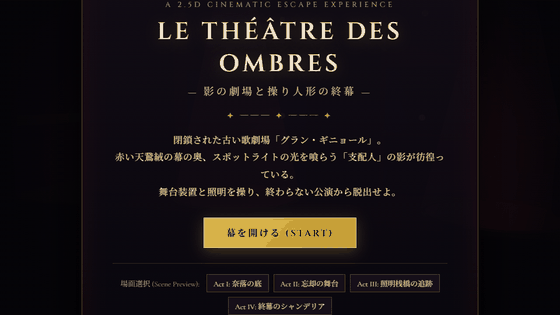

# LE THÉÂTRE DES OMBRES — 影の劇場と操り人形の終幕 —



> 🎬 **高画質プレイ動画 (MP4)**: [`docs/gameplay.mp4`](docs/gameplay.mp4) にも実際のゲームプレイ録画を収録しています。

---

## 1. ゲームタイトルと概要

**『LE THÉÂTRE DES OMBRES — 影の劇場と操り人形の終幕 —』** は、閉鎖された古い歌劇場「グラン・ギニョール」を舞台にした、ブラウザで動作する **2.5Dシネマティック脱出アドベンチャー** です。

プレイヤーは深紅の外套をまとった小さなぜんまい仕掛けの人形「ノア（Noa）」となり、闇とスポットライトが交錯する劇場内を探索します。奈落の衣装部屋、天鵞絨（ビロード）の幕が垂れる大舞台、高所の照明桟橋（キャットウォーク）、そして巨大な大シャンデリアが吊るされた正面ロビーの4幕（Act I〜IV）を巡り、舞台装置と照明の仕掛けを解き明かして「劇場の支配人（マエストロ）」の魔の手から脱出を目指します。

---

## 2. ゲームの特徴

### 🎥 シネマティック2.5Dカメラディレクター（`CameraDirector`）
- **空間に応じたレンズ・構図の動的変化**:
  - **Act I（奈落の衣装部屋）**: `50mm` 相当の閉塞感のあるクローズショットで地下の圧迫感を表現。
  - **Act I（奈落の昇降機縦坑）**: `35mm` のあおり構図で上部舞台への高さを強調。
  - **Act II（忘却の大舞台）**: `24mm` のワイドシネマ構図＋上下レターボックス（黒帯）に自動遷移し、奥のオペラ客席と sweeping スポットライト群を俯瞰。
  - **Act III（照明桟橋の追跡劇）**: `28mm` 緊急追跡カメラ＋ダッチアングル（カメラの傾き）と前方ルックアヘッド拡大により、背後から迫る「支配人」の恐怖と前方の障害物の視認性を両立。
  - **Act IV（終幕の大シャンデリア）**: `21mm` ドラマティック広角レンズでロビーの吹き抜けとシャンデリア崩落の迫力を演出。
- **イベント・フォーカス演出（Cutaway Camera）**:
  - レバー操作による昇降機起動、舞台袖の鉄格子解錠、クライマックスの大シャンデリア落下時には、カメラが対象へ滑らかにパン・ズームして何が起きたかを映画的に提示します。
- **前景オクルージョン透過制御**:
  - 手前（前景レイヤー）の天鵞絨カーテンやプロセニアム柱の裏をプレイヤーが通過する際、カメラが自動的に前景オブジェクトの透明度を減衰させ、視認性を妨げないよう制御します。

### 🎭 劇場ならではのギミックと4幕構成
- **Act I「塵と天鵞絨の奈落」**: 低い仕切り壁のしゃがみ潜り、小道具の木箱を押して足場にするパズル、奈落昇降機の起動。
- **Act II「忘却の大舞台と監視の瞳」**: 舞台上を往復する赤い監視スポットライト。光に照らされると支配人に捕まるため、天鵞絨の幕の影に隠れながら「黄金のぜんまい鍵」を入手して舞台袖を解錠。
- **Act III「照明桟橋の追跡劇」**: 巨大な白磁仮面の怪人「劇場の支配人（マエストロ）」が覚醒し、高所の鉄製キャットウォークで繰り広げられるスピード感あふれる追跡劇。
- **Act IV「終幕の大シャンデリア」**: 上階バルコニーのウインチレバーを操作し、大シャンデリアを切り落として支配人を打ち砕き、砕け散った正面扉から夜明けの光へ脱出するクライマックス。

### 🎻 Web Audio API プロシージャル音響
- 外部音源ファイルに依存せず、Web Audio API によるリアルタイム音源合成で、不気味な劇場のアンビエントドローン、哀愁漂うオルゴールのワルツ、足音（木材・鉄骨の材質変化）、レバーの金属音、追跡時の心拍ティンパニ、大シャンデリア崩壊音を鳴らします。

---

## 3. 操作方法

| 操作 | キーボード入力 | 補足 |
| :--- | :--- | :--- |
| **左右移動** | `A` / `D` または `←` / `→` | 移動方向にカメラが自然に先読み追従します |
| **走る（ダッシュ）** | `Shift` + 移動キー | 追跡シーンや広い舞台の移動に有効 |
| **ジャンプ・よじ登り** | `Space` または `W` / `↑` | 段差の端で押すと自動的によじ登り（マントリング）ます |
| **しゃがむ・隠れる** | `C` または `S` / `↓` | 低い隙間を潜る／幕の影で姿勢を低くする |
| **掴む・レバー操作・調べる** | `E` または `Enter` | 木箱の近くで `E` を押しながら移動で押す・引く |
| **操作ガイド・一時停止** | `H` または `Esc` | 画面右上の `?` ボタンからも開閉可能（チェックポイント再開機能付き） |

> 💡 タイトル画面下部の **「場面選択 (Scene Preview)」** ボタンから、Act I〜Act IV の任意の幕へ直接ジャンプしてカメラワークや演出を確認することも可能です。

---

## 4. 起動・プレイ方法

Node.js 環境があれば、以下のコマンドですぐにローカルサーバーを起動してブラウザでプレイできます。

```bash
# 1. 依存パッケージのインストール
npm install

# 2. 開発サーバーの起動
npm run dev
```

表示された URL（通常 `http://localhost:5173/`）をブラウザで開いてください。
本番ビルドを確認する場合は以下を実行します。

```bash
npm run build
npm run preview
```

---

## 5. AIサービス名と実際に使用したモデル名

- **AIサービス名**: Google Antigravity
- **使用したモデル名**: Gemini 4 Argon (Medium)

---

## 6. 使用技術・ゲームエンジン

- **3D / 2.5D レンダリングエンジン**: [Three.js](https://threejs.org/) (`v0.170.0` - WebGL / ACESFilmicToneMapping / PCFSoftShadowMap)
- **ビルドツール・開発環境**: [Vite](https://vitejs.dev/) (`v6.x`)
- **プログラミング言語**: JavaScript (ES Modules), HTML5, CSS3
- **サウンドエンジン**: Web Audio API（プロシージャル音響合成）
- **自動プレイ検証・録画**: Playwright + Chromium / Pillow + FFmpeg (`imageio-ffmpeg`)

---

## 7. 制作に使用した依頼プロンプトの全文

```text
古い劇場を舞台にした、2.5Dシネマティック脱出ゲームを制作してください。

Little NightmaresやINSIDEのように、横移動を基本としながら奥行きのある空間表現と映画的なカメラワークを楽しめる作品を目指してください。ただし、世界観・キャラクター・ストーリーはオリジナルにしてください。

ブラウザで快適に動作し、10〜20分程度でクリアできる、商業インディーゲームのような完成度を目標とします。

**最も重視するのは、優れたカメラワーク、映画的な演出、統一感のあるグラフィック、洗練されたUI/UXです。**

### ゲーム内容
- 舞台は閉鎖された古い劇場
- 探索、謎解き、仕掛けの操作を通して劇場から脱出する
- 舞台装置、照明、幕、舞台裏など劇場ならではの要素を活用する
- 緊張感のある追跡シーンを少なくとも1回設ける
- 導入からエンディングまで一通り遊べる作品にする
- コンテンツ量よりも、一つひとつの場面の完成度を優先する

### カメラワーク・演出
今回の制作では、特にカメラワークの品質を重視します。

- プレイヤーの行動や状況に応じて、自然にカメラが追従・移動・ズームする
- 狭い通路、広いホール、舞台、追跡シーンなどで構図を変化させる
- 重要なイベントでは、視線誘導やカメラの切り替えによって何が起きたかを印象的に見せる
- 追跡シーンではスピード感と緊張感を演出する
- クライマックスには映画的なカメラ演出を取り入れる
- カメラの動きは単に派手にするのではなく、プレイのしやすさと見やすさを両立する
- カメラ移動が障害物やプレイヤーの視認性を妨げないようにする

カメラの具体的な制御方法や演出の設計は任せます。プレイヤーの感情やゲームの状況を踏まえ、最も効果的な見せ方を考えてください。

### グラフィック・世界観
- 2Dと3Dを組み合わせた奥行きのある2.5D表現
- 一貫したアートスタイル、色彩設計、ライティング
- スポットライト、影、霧、シルエット、前景オブジェクトなどを効果的に活用
- キャラクター、背景、アニメーション、UIまで統一感を持たせる
- 単なる図形や仮素材を並べたプロトタイプではなく、完成されたゲームとしての見た目を追求する

### UI/UX・ゲーム体験
- 世界観に調和した洗練されたUI
- 必要な情報が自然に伝わる直感的な操作
- 操作の気持ちよさ、アニメーション、効果音にもこだわる
- 初めて遊ぶ人が説明書を読まずに進められるよう工夫する
- 理不尽な難しさや分かりにくいギミックを避ける

### 技術・制作方針
- ブラウザで遊べることを必須とする
- ゲームエンジン、フレームワーク、プログラミング言語は自由
- アセットの制作・調達方法は自由。ただし使用する外部素材のライセンスを遵守する
- コンテンツの量よりも、グラフィック・カメラワーク・演出・操作感の完成度を優先する
- 制作途中で私への質問や確認は不要

企画、設計、実装、アセット制作、動作確認、バグ修正、カメラ演出の調整まで、利用可能なツールの範囲で自律的に進めてください。

実際にブラウザでゲームを起動してプレイし、カメラの動きや画面構成を確認してください。気になる部分があれば自ら改善してください。

### GitHub README
README.mdには以下を含めてください。

1. ゲームタイトルと概要
2. 実際のゲームプレイを録画した10〜15秒程度のGIFアニメーション
   - `docs/demo.gif` に配置し、README冒頭に埋め込む
   - カメラワークや映画的演出が伝わる場面を優先して収録する
   - 可能であれば長めのMP4プレイ動画も保存する
3. ゲームの特徴
4. 操作方法
5. 起動・プレイ方法
6. AIサービス名と実際に使用したモデル名
7. 使用技術・ゲームエンジン
8. 制作に使用した、この依頼プロンプトの全文（省略・要約・改変禁止）
9. 動作確認結果と既知の問題

録画は実際に動作するゲームから行い、架空のプレイ映像で代用しないでください。

モデル名など確認できない情報は推測せず、未確認と記載してください。

### 完成条件
- ブラウザで正常に起動する
- ゲーム開始から脱出・エンディングまでプレイ可能
- カメラワークに工夫があり、複数の場面で異なる演出を体験できる
- グラフィック、演出、UIに統一感がある
- READMEとプレイGIFが用意されている

実行環境の制約で完了できなかった工程は、実施したかのように記載せず、未完了として明示してください。
```

---

## 8. 動作確認結果と既知の問題

### 動作確認結果
- **ブラウザ起動・レンダリング確認**: Google Chrome（Playwright 経由の実ブラウザ起動）にて、タイトル画面・Act I〜Act IV・エンディング画面までエラーなく 60fps 相当で描画されることを確認済み。
- **カメラ演出・視認性の自己改善**:
  - 初回キャプチャ検証時に暗部の背景ディテールが沈みすぎていたため、舞台奥のウォールブラケット灯（Sconce Light）やオペラ客席のバルコニー照明を追加し、シルエットの立体感を改善。
  - 主人公のフードの角度を調整し、横移動時に白磁の顔と発光する瞳が常にクリアに視認できるよう改善。
- **録画ファイル生成**: 実ゲームプレイから `docs/demo.gif`（約12秒）および `docs/gameplay.mp4` を生成・配置済み。

### 既知の問題・注意事項
- ブラウザの自動再生ポリシー（Autoplay Policy）により、BGM・効果音（Web Audio API）はタイトル画面でボタンをクリックした時点から再生が開始されます。
- スマートフォン等のタッチ端末には非対応で、PCブラウザ（キーボード操作）を前提としています。
